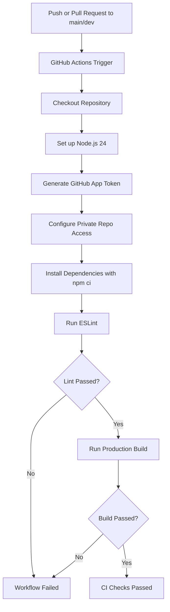

# GitHub Actions CI Pipeline Documentation

## 1. Why the Workflow Triggers on Both `main` and `dev`

Our GitHub Actions CI workflow runs on both the `main` and `dev` branches to ensure code quality and stability throughout the development lifecycle.

- **`dev` branch:** Acts as our staging ground, where everyday feature branches are merged and undergo automated checks before progressing toward production.
- **`main` branch:** Represents production-ready code. Running CI checks on this branch ensures that the code remains stable and reliable before deployment or release.

Testing both branches ensures that bugs are intercepted early, long before they reach staging or production environments.

### Why Concurrency Control Is Enabled

```yaml
concurrency:
  group: ci-${{ github.workflow }}-${{ github.ref }}
  cancel-in-progress: true
```

We enable `cancel-in-progress: true` to prevent outdated workflow runs from consuming unnecessary resources.

For example, if a developer pushes three consecutive commits while debugging:

1. GitHub Actions starts the CI workflow for the first commit.
2. A second commit triggers another workflow run.
3. A third commit triggers a new workflow run.
4. The older, in-progress runs are automatically canceled, and the latest run continues.

This helps:

- Save valuable GitHub Actions runner minutes.
- Reduce unnecessary server resource consumption.
- Prevent outdated commits from completing redundant CI checks.
- Ensure the latest code changes receive the most relevant validation.

---

## 2. Step-by-Step Architecture Breakdown

### Step 1 & 2: Environment Provisioning and Checkout

```yaml
steps:
  - name: Checkout Code
    uses: actions/checkout@v4
    with:
      persist-credentials: false

  - name: Set up Node.js
    uses: actions/setup-node@v4
    with:
      node-version: 24
      cache: npm
```

#### Checkout Code

The `actions/checkout@v4` action retrieves the repository's source code into the GitHub Actions runner.

```yaml
persist-credentials: false
```

**Why we use it:**

By default, `actions/checkout` persists its authentication credentials in the local Git configuration.

Setting `persist-credentials: false` prevents the checkout action from leaving its default `GITHUB_TOKEN` credentials in the local Git configuration.

This is important because our workflow subsequently configures custom Git URL rewriting rules to authenticate with private repositories.

Disabling credential persistence helps prevent conflicts between the default checkout credentials and our custom authentication configuration.

#### Set up Node.js

```yaml
- name: Set up Node.js
  uses: actions/setup-node@v4
  with:
    node-version: 24
    cache: npm
```

**Why we use it:**

- **Node.js 24:** Provides a consistent Node.js environment for executing our frontend application and its development tools.
- **npm caching:** Enables caching of npm package data between workflow runs.
- **Faster installations:** Reduces unnecessary package downloads and improves pipeline execution time.

The npm cache is used to speed up dependency installation. It does not directly cache the entire `node_modules` directory.

---

### Step 3 & 4: Private Package Bridge (GitHub App Token and URL Rewriting)

This is the most critical section of the pipeline for resolving private repository dependencies.

Our frontend application depends on the private `repo-proto` repository maintained under the `SV-TechnologiesPvtLtd` GitHub organization.

Since GitHub Actions runners operate in isolated environments, they do not automatically have access to our private repositories.

We therefore generate a temporary GitHub App installation token and configure Git to use it when accessing the private repository.

#### Generate GitHub App Token

```yaml
- name: Generate GitHub App Token
  id: generate_token
  uses: actions/create-github-app-token@v1
  with:
    app-id: ${{ secrets.INVOICE_FRONTEND_APP_ID }}
    private-key: ${{ secrets.INVOICE_FRONTEND_APP_PRIVATE_KEY }}
    owner: SV-TechnologiesPvtLtd
    repositories: repo-proto
```

**Why we use a GitHub App Token instead of a Personal Access Token (PAT):**

A GitHub App provides a more maintainable and organization-managed authentication approach.

Advantages include:

- **Organization ownership:** Authentication is associated with the GitHub App rather than an individual employee.
- **Repository-level access:** The app can be granted access only to the repositories it needs.
- **Short-lived credentials:** Installation tokens are generated dynamically and expire automatically.
- **Reduced dependency on individual accounts:** Authentication is less likely to be disrupted when an employee leaves the organization or changes their personal account credentials.

The GitHub App must have the appropriate repository permissions and installation access to generate a token successfully.

---

#### Configure Private Repository Access

```yaml
- name: Configure Private Repo Access
  run: |
    AUTH_URL="https://x-access-token:${{ steps.generate_token.outputs.token }}@github.com/SV-TechnologiesPvtLtd/"

    git config --global \
      url."$AUTH_URL".insteadOf \
      "ssh://git@github.com/SV-TechnologiesPvtLtd/"

    git config --global --add \
      url."$AUTH_URL".insteadOf \
      "git@github.com:SV-TechnologiesPvtLtd/"

    git config --global --add \
      url."$AUTH_URL".insteadOf \
      "https://github.com/SV-TechnologiesPvtLtd/"
```

**Why we use Git URL rewriting (`insteadOf`):**

Our `package-lock.json` and Git-based dependencies may reference private repositories using standard Git URL formats, such as:

```text
ssh://git@github.com/SV-TechnologiesPvtLtd/repo-proto.git
```

```text
git@github.com:SV-TechnologiesPvtLtd/repo-proto.git
```

```text
https://github.com/SV-TechnologiesPvtLtd/repo-proto.git
```

However, the isolated GitHub Actions runner does not automatically have the SSH keys or authentication credentials required to access these private repositories.

The `insteadOf` configuration allows Git to automatically rewrite matching repository URLs.

For example:

```text
Original URL:
git@github.com:SV-TechnologiesPvtLtd/repo-proto.git
```

Git rewrites the URL using the authenticated HTTPS prefix:

```text
https://x-access-token:<APP_TOKEN>@github.com/SV-TechnologiesPvtLtd/repo-proto.git
```

This allows Git to authenticate using the generated GitHub App token without requiring SSH keys.

**Important:** The token is temporary and should never be printed in workflow logs or committed to the repository.

---

### Step 5: Clean Installation (`npm ci`)

```yaml
- name: Install Dependencies
  run: npm ci
```

#### Why we use `npm ci` instead of `npm install`

`npm ci` is designed for automated environments such as CI pipelines.

It provides a clean and reproducible dependency installation process.

Advantages:

- Removes the existing `node_modules` directory before installation.
- Installs dependencies strictly according to `package-lock.json`.
- Fails if the lockfile and `package.json` are inconsistent.
- Avoids modifying the lockfile during installation.
- Ensures consistent dependency versions across local development and CI environments.

This helps eliminate unexpected dependency differences between developers' machines and GitHub Actions runners.

---

### Step 6, 7 & 8: Quality Gates and Build Verification

After installing dependencies, the workflow performs automated code quality checks and verifies that the application can be built successfully.

#### Linting

```yaml
- name: Lint
  run: npm run lint
```

**Purpose:**

Linting acts as an automated code quality gate.

It helps identify:

- Syntax and formatting issues.
- Potential code errors.
- Unused variables and imports.
- Incorrect React or TypeScript patterns.
- Code quality violations defined by our ESLint configuration.

For example, depending on our ESLint rules, linting can identify incorrect React hook usage or unnecessary code patterns before they reach the staging or production branches.

If linting fails, the workflow stops and reports the failure.

#### Production Build

```yaml
- name: Build
  run: npm run build
```

**Purpose:**

The production build verifies that our application can compile successfully using the configured build process.

It helps detect:

- TypeScript compilation errors.
- Missing imports or dependencies.
- Invalid application code.
- Build configuration issues.
- Production compilation failures.

This ensures that the application is technically capable of producing a production build before the code is merged.

---

## 3. Overall CI Pipeline Flow



The pipeline follows a sequential execution model.

Each step must complete successfully before the next step executes.

If dependency installation, linting, or production compilation fails, the workflow reports the failure and prevents the pipeline from being marked as successful.

---

## 4. Maintenance and Future Reference Checklist

When revisiting this workflow in the future, use the following checklist to troubleshoot authentication, dependency installation, and build issues.

### GitHub App Authentication

If authentication starts failing with `403 Forbidden` or repository access errors:

- Verify that `INVOICE_FRONTEND_APP_ID` is correctly configured in GitHub repository secrets.
- Verify that `INVOICE_FRONTEND_APP_PRIVATE_KEY` contains the valid GitHub App private key.
- Confirm that the GitHub App is installed under the `SV-TechnologiesPvtLtd` organization.
- Confirm that the app has access to the `repo-proto` repository.
- Verify that the app has sufficient repository permissions to read the private repository.
- Check whether the GitHub App installation or its permissions have changed.

### Node.js Version Updates

If Node.js 24 reaches End-of-Life or the project upgrades its runtime:

- Update the `node-version` parameter in `actions/setup-node`.
- Ensure the selected Node.js version is compatible with the project's dependencies.
- Update the local development environment to use the same supported Node.js version.
- Verify that the npm version and lockfile remain compatible.

### Adding New Private Repositories

If the frontend application starts depending on another private repository within `SV-TechnologiesPvtLtd`:

- Update the `repositories` list in the GitHub App token generation step.
- Ensure the GitHub App has installation access to the new repository.
- Confirm that the repository uses a URL format covered by the Git URL rewriting configuration.
- Verify that the dependency can be installed successfully using `npm ci`.

### Dependency Installation Issues

If `npm ci` fails:

- Check whether `package.json` and `package-lock.json` are synchronized.
- Verify that private package URLs are correct.
- Confirm that the GitHub App token is available and valid.
- Ensure the required private repositories are accessible.
- Check whether the Node.js version is compatible with the project dependencies.

### Linting and Build Failures

If linting or the production build fails:

- Review the GitHub Actions logs for the exact error.
- Reproduce the issue locally using the same Node.js version.
- Run `npm run lint` to identify code quality issues.
- Run `npm run build` to reproduce compilation errors.
- Fix the issue and push the updated changes.

---

## 5. Summary

Our GitHub Actions CI pipeline provides an automated quality gate for both the `dev` and `main` branches.

It ensures that:

- Code is checked out in a clean environment.
- Node.js is configured consistently.
- Private repository dependencies are authenticated securely using a GitHub App.
- Dependencies are installed reproducibly using `npm ci`.
- Code quality is verified through linting.
- The application is validated through a production build.
- Outdated workflow runs are canceled to reduce unnecessary resource consumption.

By implementing these checks, we improve code reliability, maintain consistent development environments, and reduce the likelihood of introducing issues into staging or production.

**The goal is to identify problems as early as possible and ensure that every change meets our project's quality standards before it progresses through the development lifecycle.**
